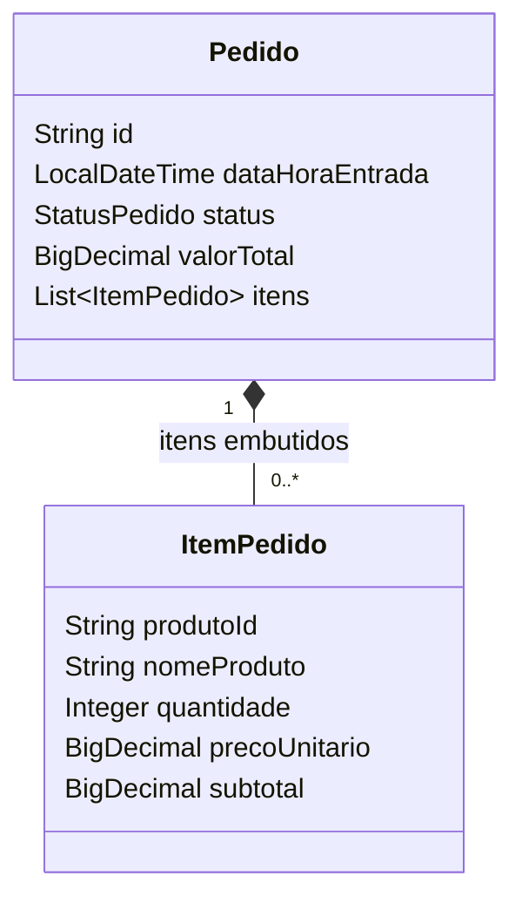

# Requisitos e projeto

## Contexto

O responsável pelo estabelecimento precisa acompanhar vendas, pedidos e produtos de maior saída sem consultar cada pedido individualmente. O dashboard transforma os dados já registrados no Pediu Patrão em indicadores e visualizações.

## Requisitos funcionais

| Código | Requisito e critério de aceitação |
| --- | --- |
| RF01 | Exibir faturamento, quantidade de pedidos finalizados, ticket médio e cancelamentos no período. Sem finalizados, faturamento e ticket são zero. |
| RF02 | Exibir gráfico de barras de faturamento por dia, em ordem cronológica, incluindo dias com zero. Disponibilizar os mesmos valores em tabela. |
| RF03 | Exibir gráfico e lista com contagem em cada um dos sete status do sistema, inclusive status sem pedidos. |
| RF04 | Exibir os cinco produtos mais vendidos em unidades, considerando pedidos finalizados e agrupando pelo identificador do produto. |
| RF05 | Permitir data inicial e final inclusivas, além dos atalhos hoje, últimos sete e últimos 30 dias. Rejeitar período invertido e mais de 366 dias. |
| RF06 | Consumir os endpoints do próprio sistema por `fetch`, sem valores simulados na interface e sem expor entidades completas. |
| RF07 | Consultar ao abrir a página e ao atualizar; indicar carregamento, impedir atualização simultânea, exibir estado vazio e erros; ocultar resultados anteriores quando a nova consulta falha. |

## Requisitos não funcionais

| Código | Requisito |
| --- | --- |
| RNF01 — Segurança | Página e endpoints acessíveis somente por ADMIN e GERENTE. A autenticação reutiliza a sessão existente; ATENDENTE recebe 403. |
| RNF02 — Precisão | Usar `BigDecimal` para cálculos monetários. Ticket arredondado para duas casas com HALF_UP. |
| RNF03 — Manutenção | Separar controller, service, repository e DTO; reaproveitar entidades e infraestrutura do projeto. |
| RNF04 — Usabilidade | Formatar valores em reais e datas em português; manter labels nos filtros, mensagens anunciadas por leitores de tela e alternativa textual aos gráficos. |
| RNF05 — Responsividade | Organizar cartões e gráficos em colunas que se adaptam a telas pequenas; permitir rolagem da tabela quando necessário. |
| RNF06 — Confiabilidade | Responder 400 a filtros inválidos, esconder detalhes internos em erros 500 e registrar a exceção no servidor. |
| RNF07 — Consulta limitada | Consultar no máximo 366 dias por requisição. Limitar o ranking da API a 50 produtos; a página pede cinco. A interface encerra a espera após 20 segundos, sem promessa de tempo de resposta do servidor. |
| RNF08 — Verificação | Manter testes automatizados de cálculos, HTTP, autorização, template e estados JavaScript; registrar limites dos testes. |

## Regras de negócio

1. O filtro seleciona pedidos por `dataHoraEntrada`, independentemente do status.
2. O intervalo no banco é `[dataInicial 00:00, dia seguinte à dataFinal 00:00)`. Isso inclui o último dia inteiro, sem depender de precisão de milissegundos.
3. Faturamento soma `valorTotal` dos pedidos atualmente FINALIZADO. O desconto já está refletido nesse campo.
4. Ticket médio divide esse faturamento pela quantidade de finalizados. Sem finalizados, retorna `0.00`.
5. CANCELADO é contado separadamente e não participa do faturamento nem do ranking.
6. RETIRADO e SAIU_PARA_ENTREGA não são considerados finalizados; o fluxo existente permite sua transição para FINALIZADO.
7. O ranking soma `quantidade` dos itens pelo `produtoId`. Produtos com o mesmo nome e IDs diferentes não são combinados. Em empate de quantidade, ordenar por ID para manter estabilidade. O nome exibido é o nome armazenado em um dos itens encontrados para esse ID, sem consulta ao cadastro atual.
8. Os valores dos gráficos e indicadores vêm dos pedidos, preservando preços e descontos históricos. Alterar o preço atual do produto não recalcula pedidos anteriores.
9. Pedido finalizado com valor ausente ou itens inválidos no ranking gera erro, em vez de um resultado que pareça correto com dados incompletos.
10. Não há conceito de pagamento registrado nesse modelo. Por isso o indicador se chama faturamento de pedidos finalizados, sem afirmar recebimento financeiro.

## Modelo de dados utilizado

Os documentos permanecem na coleção `pedidos`. A funcionalidade não exige uma nova coleção nem migração. A referência ao produto nos itens é feita pelo ID; nome e preço também ficam no pedido para preservar seu contexto histórico.

## Decisões de projeto

- **Mesmo backend e Thymeleaf:** aproveita login, menu e implantação existentes, sem introduzir outro projeto ou configuração de CORS.
- **API separada da página:** os indicadores podem ser testados independentemente da renderização e consumidos por outro cliente autenticado.
- **DTOs:** expõem somente os dados necessários ao painel, sem informações de clientes ou responsáveis dos pedidos.
- **Filtro no MongoDB:** evita buscar a coleção inteira para depois selecionar datas em Java.
- **Chart.js local:** reutiliza a versão 2.9.4 já presente; os dados também aparecem em tabela/lista.
- **Atualização manual:** o responsável decide quando consultar novamente. O botão é desabilitado durante a busca para evitar cliques repetidos.
